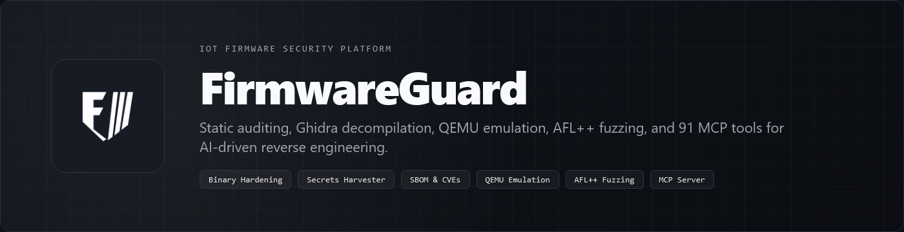

<div align="center">
  

  <h1>FirmwareGuard</h1>
  <p><strong>AI-assisted IoT firmware reverse engineering, static auditing, QEMU emulation, and AFL++ fuzzing in one self-hosted workspace.</strong></p>

  <p>
    <a href="https://despwn.github.io/firmwareguard/"></a>
    <a href="LICENSE"></a>
    
    
    
  </p>

  <p>
    <a href="#quick-start">Quick Start</a> ·
    <a href="#capabilities">Capabilities</a> ·
    <a href="#architecture">Architecture</a> ·
    <a href="#ai-integration-mcp">MCP Tools (91)</a> ·
    <a href="#security--remote-access">Security</a> ·
    <a href="https://despwn.github.io/firmwareguard/">Full Docs</a>
  </p>
</div>

---

Drop an embedded Linux firmware image into FirmwareGuard and it unpacks the filesystem, audits every ELF binary, harvests credentials and keys, maps out CVEs, boots the image in QEMU, and fuzzes target binaries with AFL++ — all from a single web UI or through an AI coding assistant over [Model Context Protocol (MCP)](https://modelcontextprotocol.io/).

No separate cloud API billing required for AI workflows. Connect Claude Code, Claude Desktop, or any MCP-compatible client directly to the local server and drive 91 firmware-analysis tools with your existing subscription.

## Quick Start

You need [Docker](https://docs.docker.com/get-docker/) and Docker Compose. That's it.

```bash
git clone https://github.com/desPWN/firmwareguard.git
cd firmwareguard
cp .env.example .env
docker compose up -d --build
```

Once the containers come up:

- **Web UI:** http://localhost:3000
- **API Docs (Swagger):** http://127.0.0.1:8000/docs
- **Hosted Documentation:** https://despwn.github.io/firmwareguard/

> **First build note:** The initial `docker compose up --build` compiles `sasquatch`, installs Ghidra 11.3.1, and builds QEMU + AFL++ containers. Expect 5–10 minutes on the first run; rebuilds after that hit Docker layer cache and finish in seconds.

## Capabilities

| Module | What it does |
| :--- | :--- |
| **Firmware Unpacking** | Extracts SquashFS (including vendor-modified formats via `sasquatch`), JFFS2, UBIFS, CramFS, ext, and CPIO images automatically with multi-partition support. |
| **File Explorer** | Virtual filesystem tree, syntax-highlighted code viewer (Monaco), hex viewer, and full-text search across the extracted rootfs. |
| **Binary Hardening Audit** | Scans every ELF executable and shared library for NX, Stack Canary, PIE, Full/Partial RELRO, and FORTIFY, scoring the overall posture. |
| **Secrets & Credential Harvester** | Extracts unencrypted private keys, expired/weak X.509 certificates, router config defaults, and `/etc/shadow` accounts with built-in IoT default password cracking. |
| **Binary Analysis & Decompilation** | Function listing, disassembly, cross-references, stack/global layout, taint tracking, and headless Ghidra 11.3.1 C decompilation. |
| **Component Dependency Map** | Interactive ReactFlow + Dagre graph showing shared library dependencies, executables, and init scripts. |
| **SBOM & CVE Scanning** | Generates CycloneDX SBOMs, matches components against the NVD database, and supports false-positive triage plus AI severity justification. |
| **QEMU Firmware Emulation** | Runs single binaries (user-mode) or boots full rootfs images (system-mode) for ARM, MIPS, MIPSel, and AArch64 inside isolated, read-only-staged containers with GDB support. |
| **AFL++ Cross-Arch Fuzzing** | Fuzzes embedded binaries in QEMU mode with automatic seed corpus/dictionary generation, custom `desock` network preloading, and crash triage. |
| **Firmware Comparison** | Diffs filesystem trees, ELF binaries, and decompiled functions across two firmware versions of the same device. |
| **Live Device UART** | Connects to physical hardware serial ports over a host-side TCP bridge (`scripts/firmwareguard-uart-bridge.py`). |
| **Enriched Reports** | Exports security assessments to Markdown or PDF — automatically bundling executive findings, hardening metrics, secrets summaries, and top CVEs. |

## Architecture

```text
  Browser / Remote Client               Claude Code / Claude Desktop / MCP Client
            │                                              │
            │ HTTP / WebSocket (port 3000)                 │ MCP over stdio
            ▼                                              ▼
  ┌───────────────────┐                          ┌────────────────────┐
  │  Nginx + React 19 │                          │  firmwareguard-mcp │
  │  (Code-split SPA) │                          │     (91 tools)     │
  └─────────┬─────────┘                          └─────────┬──────────┘
            │ /api/* proxy                                 │
            ▼                                              ▼
  ┌───────────────────────────────────────────────────────────────────┐
  │                   FastAPI Backend (Python 3.12)                   │
  │   Unpack · Hardening · Secrets · Ghidra · SBOM · Diff · Reports   │
  └──────┬───────────────────┬─────────────────────┬──────────────────┘
         │                   │                     │ Docker SDK
         ▼                   ▼                     ▼
  ┌─────────────┐     ┌─────────────┐     ┌───────────────────────────┐
  │ PostgreSQL  │     │   Redis 7   │     │   Isolated Containers     │
  │ (127.0.0.1) │     │ (127.0.0.1) │     │  QEMU Emulation │ AFL++   │
  └─────────────┘     └─────────────┘     └───────────────────────────┘
```

All internal services (PostgreSQL, Redis, and the FastAPI port) bind strictly to `127.0.0.1`. Nginx on port `3000` is the single exposed gateway.

## Security & Remote Access

FirmwareGuard runs without a login screen on localhost by default so local reverse engineering stays fast. Before exposing it over a LAN or a public tunnel, enable the built-in password gate in `.env`:

```env
AUTH_PASSWORD=choose-a-strong-password
ENABLE_HOST_TERMINAL=false
```

Then restart the backend:

```bash
docker compose up -d backend
```

- **Auth Gate:** Setting `AUTH_PASSWORD` locks every `/api/v1/*` route and WebSocket behind an `HttpOnly` signed session cookie (or `Authorization: Bearer` header for scripts).
- **Host Shell Disabled by Default:** `ENABLE_HOST_TERMINAL` defaults to `false` so nobody can open a `/bin/bash` PTY inside the backend container. Isolated QEMU Emulation terminals stay available.
- **No Port-Forwarding Required:** If you want temporary HTTPS access from another device without opening router ports, point [Cloudflare Tunnel](https://developers.cloudflare.com/cloudflare-one/connections/connect-networks/) at port `3000`:
  ```bash
  cloudflared tunnel --url http://127.0.0.1:3000
  ```

## AI Integration (MCP)

Register FirmwareGuard's MCP server with your AI client so it can inspect files, decompile functions, boot QEMU sessions, run AFL++ campaigns, and log findings directly.

### Claude Code

```bash
claude mcp add firmwareguard -- docker exec -i firmwareguard-backend-1 uv run firmwareguard-mcp --project-id <PROJECT_ID>
```

### Claude Desktop

Add this entry to `claude_desktop_config.json`:

```json
{
  "mcpServers": {
    "firmwareguard": {
      "command": "docker",
      "args": [
        "exec", "-i", "firmwareguard-backend-1",
        "uv", "run", "firmwareguard-mcp",
        "--project-id", "<PROJECT_ID>"
      ]
    }
  }
}
```

You can switch active projects at any time using the `switch_project` tool — no restart required.

<details>
<summary><strong>Browse all 91 MCP tools by category</strong></summary>

| Category | Tools |
| :--- | :--- |
| **Project (3)** | `get_project_info`, `switch_project`, `list_projects` |
| **Filesystem (8)** | `list_directory`, `read_file`, `search_files`, `file_info`, `find_files_by_type`, `get_component_map`, `get_firmware_metadata`, `extract_bootloader_env` |
| **Strings & Secrets (4)** | `extract_strings`, `search_strings`, `find_crypto_material`, `find_hardcoded_credentials` |
| **Binary Analysis (18)** | `list_functions`, `disassemble_function`, `decompile_function`, `list_imports`, `list_exports`, `xrefs_to`, `xrefs_from`, `get_binary_info`, `check_binary_protections`, `check_all_binary_protections`, `find_string_refs`, `resolve_import`, `find_callers`, `search_binary_content`, `get_stack_layout`, `get_global_layout`, `trace_dataflow`, `cross_binary_dataflow` |
| **Security Checks (6)** | `check_known_cves`, `analyze_config_security`, `check_setuid_binaries`, `analyze_init_scripts`, `check_filesystem_permissions`, `analyze_certificate` |
| **SBOM & CVEs (6)** | `generate_sbom`, `get_sbom_components`, `check_component_cves`, `run_vulnerability_scan`, `list_vulnerabilities_for_assessment`, `assess_vulnerabilities` |
| **Emulation (15)** | `list_available_kernels`, `download_kernel`, `start_emulation`, `run_command_in_emulation`, `stop_emulation`, `check_emulation_status`, `get_emulation_logs`, `diagnose_emulation_environment`, `troubleshoot_emulation`, `enumerate_emulation_services`, `get_crash_dump`, `run_gdb_command`, `save_emulation_preset`, `list_emulation_presets`, `start_emulation_from_preset` |
| **Fuzzing (9)** | `analyze_fuzzing_target`, `generate_fuzzing_dictionary`, `generate_seed_corpus`, `start_fuzzing_campaign`, `check_fuzzing_status`, `stop_fuzzing_campaign`, `generate_fuzzing_harness`, `triage_fuzzing_crash`, `diagnose_fuzzing_campaign` |
| **Comparison (4)** | `list_firmware_versions`, `diff_firmware`, `diff_binary`, `diff_decompilation` |
| **UART Console (8)** | `uart_connect`, `uart_send_command`, `uart_read`, `uart_send_break`, `uart_send_raw`, `uart_disconnect`, `uart_status`, `uart_get_transcript` |
| **Findings & Docs (9)** | `add_finding`, `list_findings`, `update_finding`, `read_scratchpad`, `update_scratchpad`, `save_document`, `read_project_instructions`, `list_project_documents`, `read_project_document` |
| **Code Cleanup (1)** | `save_code_cleanup` |

</details>

## Local Development & Tests

```bash
# Start Postgres and Redis
docker compose up -d postgres redis

# Backend (requires uv)
cd backend
uv sync
uv run alembic upgrade head
uv run uvicorn app.main:app --reload --host 127.0.0.1 --port 8000

# Frontend (separate terminal)
cd frontend
npm ci
npm run dev
```

Run the backend test suite inside the container:

```bash
docker exec firmwareguard-backend-1 uv run --with pytest --with pytest-asyncio pytest tests/ -q
```

## Configuration

Settings live in `.env` (copied from [`.env.example`](.env.example)):

| Variable | Default | Purpose |
| :--- | :--- | :--- |
| `AUTH_PASSWORD` | *(empty)* | Enables login gate for UI, REST API, and WebSockets when set. |
| `ENABLE_HOST_TERMINAL` | `false` | Allows `/bin/bash` inside the backend container (leave `false` when shared). |
| `MAX_UPLOAD_SIZE_MB` | `500` | Enforced streaming cap for firmware uploads and project archive imports. |
| `NVD_API_KEY` | *(empty)* | Optional NIST NVD API key to raise CVE lookup rate limits. |
| `GHIDRA_TIMEOUT` | `300` | Per-function headless Ghidra decompilation timeout in seconds. |
| `FUZZING_TIMEOUT_MINUTES` | `120` | Automatic expiration cutoff for AFL++ fuzzing campaigns. |
| `UART_BRIDGE_HOST` | `host.docker.internal` | Host running `scripts/firmwareguard-uart-bridge.py`. |
| `UART_BRIDGE_PORT` | `9999` | TCP port for the host-side UART bridge. |

## Tech Stack

| Layer | Technologies |
| :--- | :--- |
| **Frontend** | React 19, TypeScript, Vite (route code-splitting), Tailwind CSS, shadcn/ui, Monaco Editor, ReactFlow + Dagre, xterm.js, Zustand |
| **Backend** | Python 3.12, FastAPI, SQLAlchemy 2.0 (async), Alembic, PostgreSQL 16, Redis 7, WeasyPrint |
| **Analysis & Dynamic** | binwalk, sasquatch, jefferson, ubi_reader, radare2, pyelftools, Ghidra 11.3.1, QEMU (user + system), AFL++ (QEMU mode), CycloneDX |
| **AI & Hardware** | Model Context Protocol (`mcp`), `pyserial` UART bridge |

## Project Structure

```text
firmwareguard/
├── backend/         # FastAPI API, async services, Alembic migrations, MCP server, pytest suite
├── frontend/        # React 19 + Vite SPA + Nginx reverse proxy config
├── emulation/       # QEMU container image, pre-bundled kernels, init & serial-exec scripts
├── fuzzing/         # AFL++ QEMU-mode container image and no-libc desock preloader
├── ghidra/          # Custom Java headless analysis scripts
├── scripts/         # PostgreSQL init script, setup helper, host-side UART bridge
├── docs/            # Technical documentation (published via MkDocs Material)
├── docker-compose.yml
└── .env.example
```

## Gotchas & Troubleshooting

- **Encrypted firmware images won't unpack:** FirmwareGuard targets unencrypted embedded Linux firmware (SquashFS, JFFS2, UBIFS, CramFS, ext, CPIO). If a vendor encrypts the entire flash image, decrypt it first before uploading.
- **Slow CVE scans:** Without an `NVD_API_KEY`, NIST throttles public API requests heavily. Grabbing a free key from NVD speeds up SBOM vulnerability scans dramatically.
- **UART bridge on Linux:** Allow Docker containers to reach TCP `9999` (`sudo iptables -I INPUT -p tcp --dport 9999 -j ACCEPT`) and keep `UART_BRIDGE_HOST=host.docker.internal`.
- **Good practice targets:** [OpenWrt](https://downloads.openwrt.org/), [DD-WRT](https://dd-wrt.com/), and [DVRF (Damn Vulnerable Router Firmware)](https://github.com/praetorian-inc/DVRF).

## License

Released under the [AGPL-3.0](LICENSE) license.
